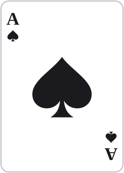
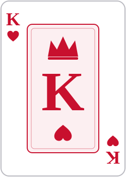
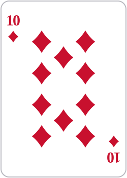
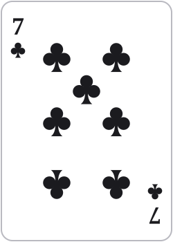
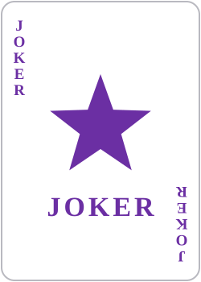
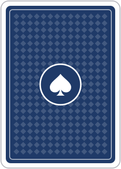

# CsDealer

A playing card library for .NET: cards, stacks, decks, configurable ranking, and built-in SVG card art.
CsDealer is a C# port of the Python [PyDealer](https://github.com/Trebek/pydealer) library.

- **Runs anywhere .NET does.** Targets `netstandard2.0` (.NET Framework 4.6.1+, Unity, Mono, Xamarin) and `net8.0`. No dependencies.
- **Fast and allocation-light.** `Card` is a 2-byte immutable struct; names, abbreviations and default card images are precomputed or cached.
- **Card images included.** Every card face and a card back render to clean, scalable SVG, either at runtime or as files in [`assets/cards`](assets/cards).

     

## Getting started

Reference the project from your own (no solution file needed):

```bash
dotnet add reference path/to/CsDealer/src/CsDealer/CsDealer.csproj
```

Or build a NuGet package and use it from any project:

```bash
dotnet pack src/CsDealer -c Release -o artifacts
```

```csharp
using CsDealer;

var deck = new Deck();          // 52 cards, Ace of Spades on top
deck.Shuffle();

Stack hand = deck.Deal(5);
hand.Sort(Ranks.Poker);

foreach (Card card in hand)
    Console.WriteLine($"{card.Abbrev,-4}{card.Name}");

List<Card> aces = hand.Get("Ace");  // removes and returns every ace
```

## Concepts

| Type | What it is |
| --- | --- |
| `Card` | Immutable value: `Value` (`CardValue`), `Suit` (`Suit?`, null for jokers), `Name` (`"Queen of Hearts"`), `Abbrev` (`"QH"`). `default(Card)` is `Card.Joker`. |
| `Stack` | An ordered pile of cards (hand, discard pile…). Index 0 is the bottom, the last index is the top. Implements `IList<Card>`, so LINQ and `foreach` work directly. |
| `Deck` | A `Stack` that builds standard decks, with optional jokers, and can `Rebuild`/`Reshuffle` automatically when dealing runs out. |
| `Ranks` | How cards compare: `Ranks.Default` (Ace high, suits break ties), `Ranks.Poker` (suits ignored), `Ranks.Big2`, or your own. It's an `IComparer<Card>` and `IEqualityComparer<Card>`. |
| `CardTools` | Helpers for any card sequence: `BuildCards`, `SortCards`, `IsSorted`, `FindCard`, `CompareStacks`, `SaveCards`/`LoadCards`, `Shuffle`. |
| `CardSvg` | Renders card faces and backs as SVG. |

### Cards

```csharp
var queen = new Card(CardValue.Queen, Suit.Hearts);
Card ace  = Card.Parse("AS");             // also "Ace of Spades", "10h", "TH", "Ace Spades", "Joker"
bool ok   = Card.TryParse(input, out Card c);

bool higher = queen > ace;                 // false: comparison operators use Ranks.Default
queen.CompareTo(ace, Ranks.Big2);          // compare with any ranking
queen.Matches("hearts");                   // true: name, abbreviation, value or suit, case-insensitive
```

### Stacks and decks

```csharp
var pile = new Stack();
pile.Add(card);                            // to the top
pile.Add(card, StackEnd.Bottom);
pile.AddRange(cards, StackEnd.Bottom);

Stack dealt  = pile.Deal(3);               // top card first; deals fewer if the pile runs out
Card top     = pile.Peek();
List<int> ix = pile.Find("Spades", limit: 2);
List<Card> x = pile.GetList(new[] { "QH", "Ace" }, sort: true);
var (bottom, upper) = pile.Split();        // halves (or Split(index))

pile.Shuffle(random: new Random(42));      // seed for reproducible games
pile.Sort(Ranks.Big2);

var shoe = new Deck(jokers: 2, rebuild: true, reshuffle: true);
shoe.Deal(200);                            // keeps building fresh decks as needed
```

### Custom ranking

```csharp
// Aces low, suits ignored.
var aceLow = new Ranks(CardTools.Values.ToDictionary(
    v => v,
    v => v == CardValue.Ace ? 1 : (int)v));

hand.Sort(aceLow);
```

### Saving and loading

```csharp
hand.SaveCards("hand.txt");                // one card name per line
hand.LoadCards("hand.txt");                // TextWriter/TextReader overloads too
```

## Card images

```csharp
string svg = card.ToSvg();                 // or CardSvg.Render(card)
string back = CardSvg.RenderBack();
string src = CardSvg.ToDataUri(svg);       // for , Blazor, WebView, etc.

CardSvg.ExportAll("wwwroot/cards");        // AS.svg, 10H.svg, JKR.svg, back.svg …

var style = new CardSvgOptions { Width = 120, FourColor = true, BackColor = "#7a1f1f" };
string fourColor = card.ToSvg(style);
```

The SVGs contain no element ids or external references, so any number can be inlined in one HTML page.
Pre-rendered files live in [`assets/cards`](assets/cards) (open `preview.html` there to see them all). Regenerate them with:

```bash
dotnet run --project samples/CsDealer.Demo -- export assets/cards
```

The card art is original and generated in code, so it ships under the same license as the library.

## Repository layout

```
src/CsDealer/            the library
tests/CsDealer.Tests/    NUnit tests
samples/CsDealer.Demo/   console demo and asset exporter
assets/cards/            pre-rendered SVG card images
```

Common commands (no solution file or Visual Studio needed):

```bash
dotnet test tests/CsDealer.Tests
```

```bash
dotnet run --project samples/CsDealer.Demo
```

On Windows the tests run twice: on .NET 8 and on .NET Framework 4.8, which exercises the `netstandard2.0` build. Line and branch coverage are 100% on both. To produce a Cobertura coverage report under `tests/CsDealer.Tests/TestResults`:

```bash
dotnet test tests/CsDealer.Tests --collect:"XPlat Code Coverage"
```

## Upgrading from 1.x

2.0 is a cleanup of the original port, and its API is not source-compatible:

- Cards use the `CardValue` and `Suit` enums instead of strings: `new Card(CardValue.Ace, Suit.Spades)` or `Card.Parse("Ace", "Spades")`. Properties are PascalCase (`card.Name`, `card.Value`).
- `Const.TOP`/`Const.BOTTOM` → `StackEnd.Top`/`StackEnd.Bottom`. Rank dictionaries → `Ranks` (`Const.DEFAULT_RANKS` → `Ranks.Default`).
- `Tools` → `CardTools`. `Stack.Cards`/`Size` → the stack itself and `Count`. `Repr()` is gone; use `ToString()`.
- `Deck(jokers: true, numJokers: 2)` → `Deck(jokers: 2)`. `Stack.Get(int)` returns the `Card`, not a list.
- Negative (Python-style) indices are no longer accepted.
- `OpenCards`/`SaveCards` with no file name → `LoadCards(path)`/`SaveCards(path)`. Old save files still load.

Bugs fixed along the way: `Find(..., sort: true)` threw `InvalidCastException`; jokers crashed searching and comparison; `Add(list, TOP)` added to the bottom; `NotEqual` and the ranked `GreaterThan…`/`LessThan…` methods returned wrong results; `IsSorted` sorted a copy of the whole stack; `Contains` built a string for every card.

## License

[AGPL-3.0](LICENSE)
